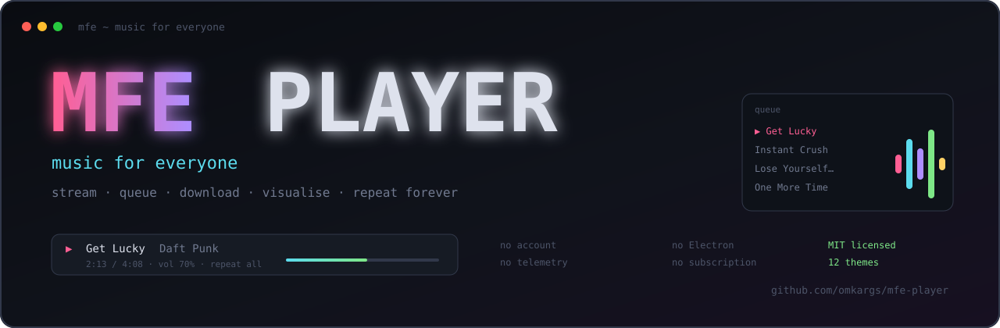

<div align="center">



### Music For Everyone.

**A terminal music player that streams, queues, downloads and visualises — with no subscription, no account, and no Electron tab eating your RAM.**

[](https://github.com/omkargs/mfe-player/actions/workflows/ci.yml)
[](https://github.com/omkargs/mfe-player/releases)
[](https://github.com/omkargs/mfe-player/stargazers)
[](LICENSE)
[](https://www.rust-lang.org)

[The rant](#-the-rant) · [Features](#-what-you-actually-get) · [Install](#-install-it) · [Keys](#-hotkeys) · [Themes](#-themes) · [Plugins](#-plugins-are-just-python) · [Roadmap](#-roadmap)

</div>

---

## The reason i build this shit :

I'm going to be honest with you: I built this because I got tired of being farmed.

I was paying for a music subscription. Then a "lossless" add-on. Then a family plan I didn't need. And after all that, the app still had ads — for the same service — and one song required three taps, two spinners and a page reload. The desktop client sat there using more RAM than my editor, my browser and my whole dev environment combined, to play a 4 MB MP3.

At some point I looked at my terminal, where I already live, and thought: **why is my music not here?**

Not "why isn't there a web player I can embed". Not "why isn't there a plugin for VS Code". Why is the one place I spend ten hours a day the *only* place I can't hit space and hear a song?

So I built it. Rust + `ratatui` + `mpv` + Python plugins. It started as "can I search and play a song without opening a browser". Then the queue showed up. Then favourites, playlists, lyrics, radio, downloads, MPRIS, a cava panel that actually moves to the audio, and a background daemon that keeps playing when your SSH session drops.

Some things I got tired of, specifically:

- **"Your music, anywhere."** Except on the one device I use.
- **Region locks** on songs that are, somehow, available for free elsewhere.
- **Hi-Fi tiers** so I can hear the ads in higher fidelity.
- **"Sign in to continue listening"** — to music I already paid for.
- **$11.99 a month**, forever, for a library I could have ripped in 2006 and owned.
- **4 GB of RAM** for a UI that needs one text box and a play button.

No account. No telemetry. No "recommended for you" — I know what I want to listen to, that's why I searched for it. No dark patterns. Just a search box, your music, and every key you need.

This is **MFE Player** — **M**usic **F**or **E**veryone. It's MIT-licensed, it's a terminal app, and it does not give a single shit about your engagement metrics.

> If this saves you one subscription, one laggy tab, or one "sorry, this content is not available in your region", that's the whole point.

---

## 🚀 What you actually get

| | |
|---|---|
| **fzf-style search** | Songs, artists and albums in one fuzzy list. `Enter` opens an artist/album page or starts playback. |
| **Spotify-ish queue** | Queue next, bulk-queue a whole view, reorder with `J`/`K`, jump to now playing, clear upcoming, undo mistakes. |
| **Plugins, not lock-in** | Metadata, streaming and lyrics are separate Python 3 plugins. Provider breaks? The player walks down the list and keeps going. |
| **Real background playback** | `Ctrl+B` detaches into a headless daemon. The queue, repeat, shuffle and radio keep running after the TUI is gone. |
| **Offline downloads** | `d` rips a track to disk and prefers the local copy next time. Planes and bad Wi-Fi are supported. |
| **Link importing** | `Ctrl+L` accepts a YouTube/SoundCloud track or playlist, or a remote `.m3u`. Paste and go. |
| **Radio autoplay** | `Ctrl+T` seeds a never-ending station from the current track so the silence never wins. |
| **Taste autoplay** | When the queue ends, a local model continues with the same vibe — learned from plays, skips and tags. Occasional probes test whether your taste moved. `mfe taste` explains every pick. |
| **MPRIS / media keys** | Works with `playerctl`, keyboard media keys and desktop widgets — even while detached. |
| **Album art in the terminal** | Cover art renders as truecolor half-blocks in the inspector — no sixel or Kitty protocol required. |
| **Cava visualiser** | `Ctrl+V` toggles a smoothed spectrum panel with fast-rise peak caps, coloured by frequency. The same energy drives every animation. |
| **14 themes** | `Alt+T` cycles live, and **preserves the comments in your config file** instead of nuking them. |
| **Looks like a modern TUI** | Motion driven by the actual audio: bass-reactive borders, a 10-band wave meter, drifting gradients, dwell-then-scroll titles, spectrum peak caps and live status chips. `Alt+M` freezes it. |
| **Blends with your wallpaper** | `Alt+W` stops painting the background, so your terminal's own transparency shows the wallpaper through the app. Panels stay solid, so text stays readable. |
| **Wallpaper palette** | `theme = "wallpaper"` (or `mfe theme adopt`) samples the wallpaper your compositor is using — swww, hyprpaper, GNOME, Plasma, macOS or Windows — and builds a matching dark palette from it. |
| **Discord Rich Presence** | Optional: friends see the track, artist and progress over Discord’s local socket. No token, no server, no history leaves the machine. |
| **Sleep timer** | `z` fades out over the last 15 seconds and pauses. No mid-chorus guillotine. |
| **Playback speed** | `[` / `]` for 0.5×–2.0×, `\` to reset. Podcasts, mixes and 10-hour loops welcome. |
| **Smart fade** | `Alt+F` ramps the volume down over the last seconds of a song and back up on the next one. No drops, no guillotines. |
| **ReplayGain** | `Alt+R` cycles off/track/album, so your own library plays at a sane loudness without dynamic-range nuking. |
| **Editable EQ** | `Ctrl+E` opens a 10-band equaliser (31 Hz–16 kHz). Nudge bands with ↑/↓, save with Enter. |
| **M3U import/export** | `Alt+E` / `Alt+I` so your playlists can escape this app too. |
| **Share without an account** | `Y` (or `mfe share`) copies the current track to your clipboard. No OAuth, no social graph, no "sign in to continue". |
| **History & stats** | Every play is remembered (`7`). `Ctrl+G` shows listening time, top artists and most-played tracks. |
| **Your own files** | Point `library_paths` at real folders and press `8`. Tags and embedded cover art are read with `lofty`; no upload, no account, no phoning home. |
| **Internet Archive** | A metadata plugin searches 800 years of free music, live sets and public-domain recordings on archive.org. |
| **Radio Browser** | Search live stations worldwide with the `Radio` plugin and pipe them straight into mpv (ICY metadata and all). |
| **Cross-platform** | Linux is the tested target. macOS builds in CI with native caches and clipboard. Windows uses mpv named pipes and is experimental until someone runs it on real hardware. |
| **Install anywhere** | One installer, plus npm/bun, pip/pipx/uv wheels, cargo, GitHub releases, Nix, AUR and a Homebrew formula — all built from the same tag. |
| **Free of charge, forever** | MIT license. One binary, roughly the size of a single album cover, and it never asks for a credit card. |

---

## 📺 What it looks like

```text
┌ library ──────┐ ┌ ⌕ search · iTunes Search ────────────────────┐ ┌ inspect ───────┐
│ 1 ⌕ search 30 │ │ ⌕  daft punk▌       Enter search/play       │ │ Get Lucky      │
│ 2 ≡ queue   4 │ │ ─────────────────────────────────────────── │ │ Daft Punk      │
│ 3 ★ favorites │ │ ▶ Get Lucky — Daft Punk        4:08         │ │ Random Access… │
│ 4 ▤ playlists │ │   Instant Crush — Daft Punk     5:37         │ │ ★ favorite     │
│ 5 ⤓ downloads │ │   Lose Yourself to Dance        5:53         │ │ y lyrics       │
│ 6 ⚙ plugins   │ │   One More Time — Daft Punk     5:20         │ │ d download     │
└───────────────┘ └─────────────────────────────────────────────┘ └────────────────┘
│ ▶ Get Lucky  Daft Punk                       2:13 / 4:08  vol 70%  repeat all │
└ / search · Enter play · a queue · F favorite · P playlist · ? help · Ctrl+P palette ┘
```

Terminal font does the rest. It looks even better with a real cava panel on the right.

---

## 🛠 Install it

### One command

```bash
curl -fsSL https://raw.githubusercontent.com/omkargs/mfe-player/master/install.sh | bash
```

This is the one I actually run. It opens with the MFE PLAYER wordmark, detects your package manager, installs **mpv, python3, yt-dlp, ffmpeg, cava and playerctl**, drops the player in `~/.local/bin`, writes bash/fish/zsh completions and finishes with `mfe doctor` so a broken audio stack is caught before you press space. No flags, no prompts. Linux and macOS.

### Pick your package manager

Every tagged release builds all of these from the same commit:

| Channel | Install | Also works |
|---|---|---|
| **Docker** | `docker compose up -d` | `Dockerfile` and `docker-compose.yml` included |
| **npm / bun** | `npm install -g mfe-player` | `bun add -g mfe-player`, `bunx mfe-player` |
| **pip / pipx / uv** | `pipx install mfe-player` | `uv tool install mfe-player`, `pip install mfe-player` |
| **cargo** | `cargo install mfe-player` | `cargo binstall mfe-player` (prebuilt, no compile) |
| **GitHub releases** | the tarball for your target triple | `install.sh` uses it automatically |
| **Arch** | `packaging/PKGBUILD` | builds from source; AUR push pending |
| **Nix** | `nix run github:omkargs/mfe-player` | `flake.nix` with runtime `PATH` wrapping |
| **Homebrew** | `packaging/homebrew/mfe-player.rb` | tap pending |
| **systemd** | `packaging/mfe-player.service` | `systemctl --user enable --now mfe-player` |

The npm packages use per-platform `optionalDependencies` (esbuild-style: **no postinstall download**, and bun gets the same package for free). The PyPI wheels are the real Rust binary via maturin `bindings = "bin"`, so no Python glue and no compiler at install time. `pip`/`pipx` install the `mfe-player` command; npm, cargo, Nix and the installer also give you the short `mfe` alias.

### Platforms

| Platform | Status | What it uses |
|---|---|---|
| **Linux** | tested | Unix socket, MPRIS, cava, the full stack |
| **macOS** | CI-built, same code path | Unix socket, `kill(pid, 0)`, `~/Library/Caches`, `pbcopy`/`pbpaste` |
| **Windows** | experimental | named-pipe mpv IPC, `DETACHED_PROCESS`, `tasklist`/`taskkill`, `clip`/PowerShell clipboard, plugins via `python3` |

CI builds Linux, macOS and Windows on every push. Windows is marked experimental until someone actually runs it on hardware and tells me what broke; the transport layer is already there, so it should be a short list.

### From source

```bash
git clone https://github.com/omkargs/mfe-player.git
cd mfe-player
cargo build --release --locked
install -Dm755 target/release/mfe-player ~/.local/bin/mfe-player
ln -sf ~/.local/bin/mfe-player ~/.local/bin/mfe
```

You need **Rust 1.85+**, **mpv**, **yt-dlp** and **python3** for the source build.

### After it is installed

```bash
mfe                     # open the TUI
mfe daft punk           # open with search results waiting
mfe status              # what's playing?
mfe toggle              # play/pause the background player
mfe stop                # stop playback and the daemon
mfe doctor              # why is the audio not playing?
mfe theme adopt         # derive the UI colours from your wallpaper
mfe taste               # what autoplay has learned about your taste
mfe discord status      # Discord presence state (on|off|client <id>)
mfe motion on|off       # reactive animations on/off (Alt+M in the app)
mfe cache               # artwork size + LRU limit
mfe update              # grab the latest release (--check to only look)
```

First launch writes sane defaults to `~/.config/mfe-player/` and installs the bundled plugins. It also migrates an old `nuclear-tui` config automatically, because losing your queue to a rename is a crime.

Not in the official distro repos yet — the packaging files are the real thing, waiting for a tap and an AUR push.

---

## ⌨️ Hotkeys

Press `?` inside the app for the full, searchable map. The ones you'll actually use:

| Key | Action |
|---|---|
| `/` · `Ctrl+F` | Search · fuzzy-filter the current view |
| `Enter` | Play · open artist/album · open playlist |
| `Space` | Play/pause (also resumes a restored queue) |
| `n` / `b` | Next / previous track |
| `←` / `→` · `Shift+←/→` | Seek −5s / +5s · −30s / +30s |
| `+` / `-` · `m` | Volume · mute |
| `[` / `]` · `\` | Speed down/up · reset to 1× |
| `s` · `r` | Shuffle · cycle repeat (off → all → one) |
| `a` · `A` | Queue selected · queue everything in view |
| `N` | Play selected next |
| `v` / `V` | Mark one / mark all |
| `f` or `F` | Favorite/unfavorite |
| `P` | Add selection to playlist |
| `J` / `K` | Reorder in queue or playlist |
| `S` | Save queue as a playlist |
| `Alt+K` · `Alt+U` | Clear upcoming · undo last removal |
| `Alt+E` · `Alt+I` | Export · import M3U |
| `d` · `5` | Download · downloads view |
| `7` · `Ctrl+G` | Listening history · listening stats |
| `8` · `R` | Local library · rescan folders |
| `Y` | Copy now playing to the clipboard |
| `Alt+F` · `Alt+R` | Smart fade cycle · replaygain cycle |
| `Ctrl+E` | Edit the 10-band EQ |
| `Ctrl+L` | Import song/playlist from a link |
| `Ctrl+T` | Toggle radio autoplay |
| `Ctrl+V` | Toggle cava spectrum |
| `z` | Sleep timer (15–90 min or end of track, fades out) |
| `E` · `Alt+N` | EQ presets · loudness normalisation |
| `Alt+T` | Cycle themes (`wallpaper` samples your desktop) |
| `Alt+W` | Transparent background |
| `Alt+M` | Motion on/off — every animation follows cava's energy |
| `Ctrl+B` | Detach and keep playing (closing the window does this automatically) |
| `Ctrl+P` or `:` | Command palette — every action, fuzzy-searchable |
| `q` | Quit and stop |

---

## 🌙 The background daemon (yes, repeat keeps working)

Most TUI players "detach" by leaving `mpv` playing one file and hoping you don't notice. When that song ends, the queue is dead.

MFE doesn't do that. `Ctrl+B` starts a tiny headless copy of the player that owns the socket, advances tracks, honours repeat/shuffle/radio, keeps MPRIS alive and persists state. Close the terminal, lock the laptop, drop the SSH connection — the music is still yours.

```bash
Ctrl+B          # TUI exits, daemon takes over
mfe status      # Bad (2012 Remaster) — Michael Jackson [background daemon, repeat all]
mfe toggle      # pause/resume from a script or keybind
mfe             # reattach the full UI right where playback is
mfe stop        # kill the music (and the daemon)
```

That's also why `repeat one` and radio survive in the background instead of quietly dying after one track. Yes, that bug annoyed me enough to build a whole daemon about it.

---

## 🧩 Status bars & scripts

`mfe` speaks JSON, so it drops straight into waybar, polybar, tmux or a shell prompt.

```bash
mfe status --json
```

```json
{"text":"▶ Get Lucky — Daft Punk","class":"playing","title":"Get Lucky","artist":"Daft Punk","position":73.2,"duration":248,"paused":false,"repeat":"all","shuffle":false,"mode":"daemon","connected":true}
```

Waybar module:

```json
"custom/mfe": {
  "exec": "mfe status --json",
  "return-type": "json",
  "interval": 1,
  "format": "{}",
  "on-click": "mfe toggle",
  "on-click-right": "mfe stop"
}
```

One-liners:

```bash
mfe current                 # ▶ Get Lucky — Daft Punk
mfe share                   # copy now playing to the clipboard
mfe toggle                  # pause/resume
mfe completions bash        # also: zsh, fish
mfe doctor                  # why is the audio not playing?
mfe cache                   # sizes + the cache limit
mfe cache clean             # free the artwork cache
mfe update                  # grab the latest release (--check to only look)
```

---

## 🎨 Themes

`Alt+T` cycles live and writes the choice back to `config.toml` **without deleting your comments**.

`mfe` · `gruvbox` · `nord` · `mono` · `matrix` · `rose` · `catppuccin` · `dracula` · `tokyo-night` · `solarized` · `amber` · `ocean`

Set one permanently:

```toml
theme = "tokyo-night"
```

No theme fits? Copy `src/theme.rs`, add 13 colours, open a PR. It's genuinely that small. Code contributions that make the terminal look less like 1998 are extremely welcome.

**Blending with your wallpaper.** Two separate problems, two switches:

1. **Stop covering it.** `Alt+W` (or `transparent = true`) leaves the base background unpainted, so whatever transparency or blur your terminal already has — and therefore your wallpaper — shows through. Panels and popups stay solid, so text stays readable even over a busy photo.
2. **Match its colours.** `theme = "wallpaper"` reads the wallpaper your compositor is actually using — swww, hyprpaper, GNOME, Plasma, macOS or Windows — and derives the panel and accent colours from it. Dark wallpaper, dark panels. Warm sunset, warm accent. Or point it at a specific file with `wallpaper = "/path/to/image.jpg"`, or run `mfe theme adopt` once.

```bash
mfe theme adopt          # sample the current wallpaper and save the choice
mfe theme list           # every built-in theme, including `wallpaper`
mfe theme                # what am I using right now?
```

Your terminal still does the actual blurring — MFE just stops painting over it. kitty, wezterm, alacritty, foot, ghostty and Konsole all support opacity. On a terminal without transparency, use the palette half: it still matches the colours.

### The rest of the look

- **Rounded borders** on every panel, popup and dialog — one border type, applied everywhere.
- **Truecolor gradient wordmark** in the header and an eighth-block progress bar (`▏▎▍▌▋▊▉`) with a gradient fill and a smooth head, instead of a flat gauge.
- **Solid chrome, transparent base.** `Alt+W` removes only the base background; lists, popups and the inspector keep their own panel colour, so text survives a busy photo.
- **Wallpaper palette** keeps the wallpaper's hue in the dark panels, pulls a vivid accent from its dominant colour and rotates the hue for a second accent. Green, yellow and red stay semantic so status still means something.
- **Graceful fallbacks.** No truecolor? The palettes approximate. No wallpaper detected? The palette half is skipped instead of guessing.

---

## 🔌 Plugins are just Python

Drop a `.py` file into `~/.config/mfe-player/plugins/`. It gets discovered, loaded and kept up to date on launch. Standard library only — no virtualenv, no build step, no dependency hell.

The bundled ones:

- **metadata** — iTunes Search API, MusicBrainz, Internet Archive, Radio Browser
- **streaming** — YouTube (`yt-dlp`), SoundCloud (`yt-dlp`), Internet Archive, Radio Browser
- **lyrics** — LRCLIB with a lyrics.ovh fallback

If one provider rate-limits you, MFE fails over to the next plugin instead of showing you a spinner forever. Adding a new source is a JSON contract, not a framework.

The trick, if you want to build one: your plugin prints JSON. That's it. `main.py search '<query>'` returns `{"artists":[],"albums":[],"tracks":[...]}`, and `main.py resolve '<track-json>'` returns `{"url":"...","extractor":"..."}`. If it works in a terminal, it works in MFE.

---

## 🧱 How it works

```text
┌──────────────┐     events      ┌──────────────┐
│   ratatui    │ ◀─────────────▶ │  app state   │
│   TUI / daemon│                │ queue · radio│
└──────┬───────┘                 └──────┬───────┘
       │ stdin / keys                   │ JSON over Unix socket
       ▼                                ▼
┌──────────────┐                 ┌──────────────┐
│ plugin worker│ ── metadata ──▶ │     mpv      │
│ python3      │ ── stream URL ─▶│ audio engine │
└──────────────┘                 └──────────────┘
```

- Rust for the UI, state machine and IPC.
- `mpv` for actual audio: gapless, prefetch, filters, MPRIS-friendly.
- Python plugins for anything that touches the internet, because providers change faster than compiled binaries.
- One shared socket; a second TUI gets a private player instead of hijacking your music.

---

## ⚙️ Config

`~/.config/mfe-player/config.toml` — every key is optional.

```toml
theme = "mfe"             # or "wallpaper" to sample your desktop
transparent = false       # Alt+W; let the terminal show what is behind it
wallpaper = ""            # explicit image for theme = "wallpaper"; empty = detect
seek_step = 5
long_seek_step = 30
volume_step = 5
prefetch = true
radio = false
mouse = true
cava = true
cava_position = "right"   # right | left
cava_bars = 28
normalize = false
eq = "flat"               # flat | bass | vocal | night | loud
audio_device = ""         # e.g. "alsa/hdmi:CARD=HDMI"
fade_seconds = 0          # 2-4 = gentle crossfade feel, 0 = off
replaygain = "off"        # off | track | album
eq_gains = [0.0, 0.0, 0.0, 0.0, 0.0, 0.0, 0.0, 0.0, 0.0, 0.0]
mpris = true
library_paths = ["~/Music"]   # scanned on launch; press R in the library view to rescan
listenbrainz_token = ""       # optional; empty = nothing ever leaves your machine
```

| Path | What lives there |
|---|---|
| `~/.config/mfe-player/config.toml` | settings |
| `~/.config/mfe-player/state.json` | queue, playlists, favorites, position |
| `~/.config/mfe-player/plugins/` | provider plugins |
| `~/.cache/mfe-player/downloads/` | offline audio |
| `~/.config/mfe-player/library.json` | local library index |
| `~/.cache/mfe-player/artwork/` | downloaded and embedded cover cache |
| `~/.config/mfe-player/mfe-player.m3u` | exported playlists |

Want scrobbles without handing over a social graph? Paste a ListenBrainz user token into `listenbrainz_token` in the config. Plays are submitted from a background thread; if the token is empty, nothing leaves your machine.

---

## 🗺 Roadmap

Shipped: search, playlists, queue, favourites, lyrics, radio, prefetch, downloads, MPRIS, cava, EQ, normalisation, sleep timer, background daemon, 14 themes, speed, smart fade, ReplayGain, ListenBrainz, Internet Archive, Radio Browser, local library, album art, history, stats, sharing, CLI JSON, transparent background, wallpaper palettes, rounded/gradient UI, macOS + Windows transport, taste autoplay, Discord Rich Presence, `mfe doctor`/`cache`/`update`, npm + PyPI + crates packaging.

The rest is a real plan, roughly in build order.

### Phase 1 — make it look like it belongs on your desktop
- [x] **Transparent background.** `Alt+W` / `transparent = true` stops painting the base background, so the terminal's own opacity/blur shows your wallpaper through the app.
- [x] **Wallpaper-aware theme.** `theme = "wallpaper"` / `mfe theme adopt` samples the current wallpaper and derives the panel/accent colours from it.
- [ ] **Album-art ambient tint.** Accent colour shifts to the dominant colour of the current cover. Opt-in.
- [ ] **ANSI-native theme.** `theme = "auto"` uses your terminal's own 16 colours, so it matches whichever theme you already run.
- [x] Rounded borders, animated gradient logo and a smooth sub-cell progress bar.
- [x] Nerd Font/ASCII icon mode (`icons = "auto" | "nerd" | "ascii"`).
- [x] Full-screen now-playing view with big art and karaoke lyrics.
- [x] Animated spectrum peaks, marquee titles, pulsing player frame and status chips.

### Phase 2 — stop it breaking outside my laptop
- [x] macOS: `/proc` replaced with `kill(pid, 0)`, native cache paths, CI build.
- [x] Windows: named-pipe mpv transport (`src/ipc.rs`), `CREATE_NO_WINDOW` spawning, `clip` clipboard, Python plugin launch, heartbeat-based daemon control and a CI build.
- [x] CI matrix for Linux/macOS/Windows so "works on my machine" stops being the test plan.
- [ ] Platform media controls: SMTC on Windows, Now Playing on macOS (MPRIS is Linux-only).

### Phase 3 — installable, and able to diagnose itself
- [x] `mfe doctor` — checks mpv, yt-dlp, python3, socket, config, plugins, clipboard and wallpaper, then prints the exact fix.
- [x] `mfe cache clean` plus `mfe cache` for a size readout.
- [x] `install.sh` (animated, installs deps, runs doctor), AUR `PKGBUILD`, Nix flake, Homebrew formula template and a systemd unit.
- [x] npm/bun (`optionalDependencies`, including Windows ARM64), pip/pipx/uv wheels via maturin, crates.io, PowerShell installer, all fed by one release workflow with checksums and `latest.json`.
- [x] `mfe update` (self-replaces from the release tarball; `--check` for scripts).
- [x] LRU eviction for the artwork cache (128 MiB, oldest covers go first).
- [ ] A `vhs` demo GIF for this README, because a wall of text is not a demo.

### Phase 4 — social, on your terms
- [ ] Last.fm scrobbling plugin (MD5 signature, no OAuth dance).
- [x] Discord Rich Presence (local IPC, opt-in, no bot token).
- [x] Opt-in desktop notifications on track change.
- [ ] Scrobble backfill from local history.

### Phase 5 — library smarts
- [ ] Smart playlists: recently added, never played, most played, on repeat.
- [ ] Bulk download an album or playlist.
- [ ] Terminal title sync: `▶ Track — Artist`, restored on exit.
- [ ] Per-track resume bookmarks for long mixes and podcasts.
- [ ] "Listening wrapped" generated from history.
- [ ] Library watch mode and duplicate detection.

Mulling but not committing: an MPD shim so `mpc`/`ncmpcpp` can drive MFE, a compact `mfe now` pane for tmux/waybar, shareable theme files (`mfe theme export/import`), podcast chapter support, and tag editing via `lofty`.

PRs for any unchecked box are welcome. So are issues that start with "this broke at 3 a.m." — those are usually the real ones. And if you're here to tell me a desktop app would be nicer: no it wouldn't, and also I'm broke.

<details>
<summary><strong>💡 The idea backlog (wants, not promises)</strong></summary>

### Blending with the desktop
- **Follow the wallpaper, not a copy.** Re-derive the palette when the compositor's wallpaper actually changes, instead of sampling once at startup.
- **Light/dark autopilot.** Sample the wallpaper's brightness and flip to a light theme when the desktop is bright.
- **Fake depth without alpha.** A subtle vertical truecolor gradient on the background, derived from the wallpaper, for terminals where opacity isn't an option.
- **Contrast guard.** When transparency is on and the wallpaper is busy, darken panels until the text is still readable — no unreadable grey-on-photo.
- **Follow the focused monitor.** On multi-head setups, sample the wallpaper of the display the terminal is actually on.
- **One palette, two sources.** Prefer album-cover colour while a track plays, wallpaper colour when idle.

### Look and feel
- **Rounded borders, accent rails, gradient logo** — the cheap stuff that makes it not look like 1999.
- **Sub-cell progress bar** (`▏▎▍▌▋▊▉`) with a separate shade for the prefetched buffer.
- **Scrollbars** in long lists, because "where am I" should not be a guess.
- **VU meter** next to the volume readout.
- **Cava styles**: bars, mirrored, dots, waveform, and a "nuclear" curve.
- **ASCII mode** for real TTYs and screen readers; Nerd Font mode for people who like glyphs.
- **Density setting**: comfortable vs compact rows.
- **Toast stack** instead of one message eating the next.
- **Animated selection** that slides instead of teleporting.
- **Theme preview grid** instead of blind-cycling twelve names.
- **Clickable OSC 8 links** in the inspector (open the track on YouTube/archive.org).
- **Terminal title sync**: `▶ Track — Artist`, restored on exit.
- **`mfe screenshot`**: dump the current view as ANSI or SVG — great for issues and READMEs.

### Music and library
- **Real crossfade** using a second mpv instance, instead of the volume ramp.
- **ReplayGain scanning** for local files (`rsgain`/`ffmpeg ebur128`) so untagged albums stop shouting.
- **Podcast RSS** subscriptions with per-episode resume and speed presets.
- **Audiobook mode**: bookmark per file, skip silence, chapter list.
- **Chapters** for long mixes and DJ sets.
- **Lyrics karaoke mode** with a timing offset nudge (`[` / `]`).
- **A-B repeat** for practice loops.
- **Smart playlists** as saved rules, not just fixed lists.
- **Duplicate finder** and a dry-run library organizer.
- **Tag editor** via `lofty` (artist/album/title/cover).
- **Library report**: formats, bitrates, missing tags, biggest files.
- **Import Last.fm history** into local stats so the graphs aren't empty.
- **Offline scrobble queue** with retry when the network comes back.

### Power-user / ecosystem
- **`mfe search "..." --json` and `mfe play <url|query>`** so the player is scriptable.
- **`mfe plugin new <name>`** scaffolding plus `mfe plugin test` to validate the JSON contract.
- **Local HTTP remote** with a token + QR code, so a phone can pause/queue without SSH.
- **Systemd user service installer** for the daemon.
- **MPD shim** so `mpc` and `ncmpcpp` can drive MFE.
- **`mfe now`** compact pane for tmux/waybar.
- **Stream Deck / rofi / dmenu** recipes in the docs.
- **Man page** generated from the CLI, not hand-written.

### Platform and distribution
- **Named-pipe IPC + platform media controls** (SMTC on Windows, Now Playing on macOS) behind one trait.
- **ARM64 and musl static releases** — Raspberry Pi deserves a music player.
- **Flatpak / AppImage / AUR / Nix / Homebrew / Scoop**.
- **CI matrix** that actually compiles all three OSes.
- **`mfe doctor`** that prints the exact fix, not just a red X.
- **`mfe update`** that checks GitHub releases.
- **Landing page** with a real demo GIF and one-line installs per distro.

### Social (without the social graph)
- **Last.fm** scrobbling and richer Discord art (source icons, listen-along links).
- **Now-playing image card**: render a small PNG with cover, title and source to paste anywhere.
- **Weekly digest / "listening wrapped"** generated from local history.
- **Desktop notifications** with cover art on track change (basic notifications already ship).

</details>

---

## 🤝 Contributing

1. Fork it.
2. `cargo build --release`
3. Break something.
4. Fix it better than I would have.
5. Open a PR with a screenshot and a one-line reason.

Read [CONTRIBUTING.md](CONTRIBUTING.md) for the boring-but-useful details. Bug reports with the output of `mfe status`, your distro and `mpv --version` get fixed about 10× faster.

If MFE saves you money, time or one browser tab: **drop a star**. Stars are how other devs find the thing, and how I know someone besides me is using it.

---

<div align="center">

**Built because renting music is a weird business model.**

MIT licensed. No ads. No trackers. No "upgrade to continue".

⭐ [Star the repo](https://github.com/omkargs/mfe-player) · 🐛 [Report a bug](https://github.com/omkargs/mfe-player/issues) · 💡 [Request a feature](https://github.com/omkargs/mfe-player/issues)

</div>
